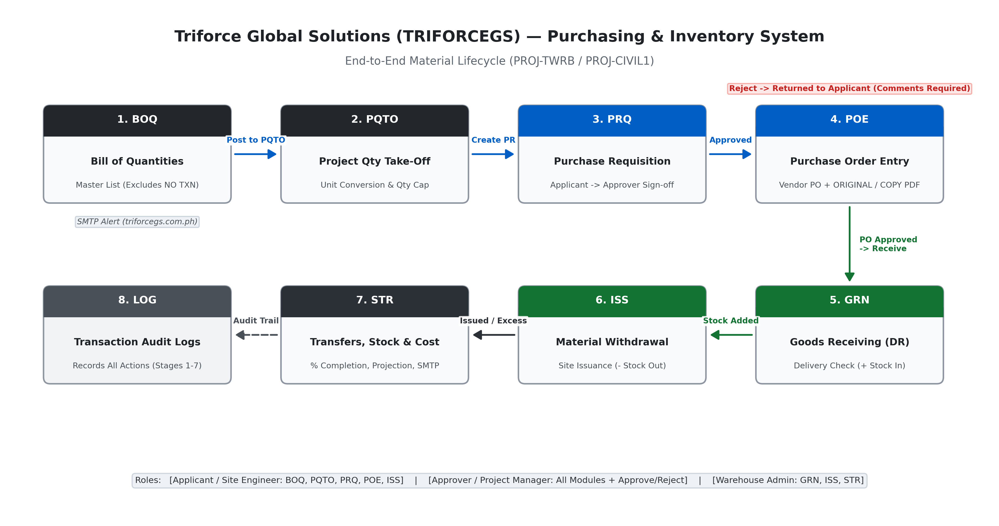

# Triforce Global Solutions (TRIFORCEGS)
## Purchasing & Inventory System - User Manual

| Document Field | Details |
| :--- | :--- |
| **Organization** | Triforce Global Solutions (TRIFORCEGS) |
| **System** | Construction Material Control & Procurement ERP |
| **Document Type** | Standard Operating Procedure (SOP) & User Guide |
| **Applicable Projects** | PROJ-TWRB (Tower B), PROJ-CIVIL1 (Site Infra) |
| **Mail Server (SMTP)** | `smtp.triforcegs.com.ph` (Port 587, TLS) |

---

## 1. Purpose and Scope

This manual defines the end-to-end operational workflow for controlling construction materials from initial engineering estimation through purchasing, warehouse receiving, site issuance, inventory auditing, and cost projection. It applies to all Site Engineers, Project Managers, and Warehouse Administrators using the system.

---

## 2. User Roles and Access Matrix

Role selection is controlled from the top-right navigation bar. Each role is restricted to the modules and actions required for segregation of duties:

| Role | Title | Accessible Modules | Primary Responsibilities |
| :--- | :--- | :--- | :--- |
| **Applicant** | Site Engineer | BOQ, PQTO, PRQ, POE, ISS, LOG | Prepares material estimates, submits Purchase Requisitions, generates Purchase Orders, and requests site material withdrawals. |
| **Approver** | Project Manager | All Modules (BOQ, PQTO, PRQ, POE, GRN, ISS, STR, LOG) | Reviews, approves, or rejects Purchase Requisitions and Purchase Orders; monitors completion and cost projections. |
| **Warehouse Admin** | Site Warehouseman | GRN, ISS, STR, POE, LOG | Verifies supplier deliveries against POs, manages warehouse stock, issues materials to site, and processes transfers/returns. |

---

## 3. End-to-End Process Flow

The procurement and inventory lifecycle follows eight sequential stages:

| Stage | Module Code | Module Name | Trigger / Output |
| :---: | :---: | :--- | :--- |
| **1** | `BOQ` | Bill of Quantities | Master material list; transactional items posted to `PQTO`. |
| **2** | `PQTO` | Project Quantity Take-Off | Converts BOQ units to purchasable units; sets quantity ceiling. |
| **3** | `PRQ` | Purchase Requisition | Formal request to purchase; requires **Approver** sign-off. |
| **4** | `POE` | Purchase Order Entry | Issued to vendor from Approved PR; requires **Approver** sign-off. |
| **5** | `GRN` | Goods Receiving | Records physical delivery via Delivery Receipt (DR); increases stock. |
| **6** | `ISS` | Material Withdrawal | Issues warehouse stock to project site; deducts available stock. |
| **7** | `STR` | Transfers, Inventory & Rules | Tracks completion %, projected cost, stock health, SMTP, and transfers. |
| **8** | `LOG` | Transaction Audit Logs | Immutable audit trail of all actions across all modules. |

---

## 4. Module Operating Procedures

### 4.1 BOQ - Bill of Quantities
1. **Data Entry & Import:** Enter line items directly in the grid or import `.csv` / `.xlsx` files via **Upload Excel/CSV**.
2. **Legacy Fittings Breakdown:** If a lump-sum row (`Fittings of the above`) is present, click **Replace "Fittings of the above"** to expand it into itemized fittings.
3. **Non-Transactional Rows:** Preliminary or labor-related items marked **Works-Related (`NO TXN`)** and blank spacer rows remain in the BOQ for reference and printing, but are excluded from purchasing.
4. **Optional PDF Export:** Click **Print BOQ (PDF)** to generate a printable BOQ specification document.
5. **Handoff to Take-Off:** Click **Post to PQTO** to generate a new PQTO record. If SMTP notifications are enabled, an automated alert is dispatched to the configured purchasing recipient.

### 4.2 PQTO - Project Quantity Take-Off
1. **Unit Conversion:** Displays BOQ quantities alongside converted take-off quantities (**PQTO Qty** and **PQTO UOM**).
2. **Quantity Control:** Tracks **PR Ordered** against **PQTO Qty** to compute **Remaining** quantity, preventing over-ordering.
3. **Initiating a Request:** Click **Create PR** to open a Purchase Requisition linked to the active PQTO.

### 4.3 PRQ - Purchase Requisition
1. **Line Item Selection:** Copy items from the PQTO lookup panel into the draft PR.
2. **Unbudgeted Items:** Click **+ New Item (Non-BOQ)** to request an item not in the original BOQ; the PR is flagged for approval.
3. **Validation & Submission:** Enter the **Reference Doc No.** and attach supporting documentation (`Browse`, `+ PDF`, or `+ JPG`), then click **Save Draft** or **Submit PR**.
   - *Note:* If **Block PR Qty exceeding PQTO Remaining Qty** is enabled in `STR`, quantities exceeding the remaining take-off balance are blocked.
4. **Approval:** Switch to the **Approver** role and click **Approve** on the pending PR, then click **To PO** to proceed.

### 4.4 POE - Purchase Order Entry
1. **PO Generation:** Select an **Approved PR**, specify the **Vendor**, **Reference Doc No.**, **IAAS2 Reference No.**, and **SP Name**, attach vendor quotes/documents, and click **Generate PO**.
2. **Approval or Rejection:**
   - **Approve:** Switch to **Approver** and click **Approve** to authorize the PO for receiving.
   - **Reject:** Click **REJECT**, enter mandatory rejection comments, and confirm. The PO status updates to **Returned to Applicant** and notifies the Applicant.
3. **Receiving Handoff:** On `Approved` or `Partially Received` POs, click **Receive** to open `GRN` for that PO.

### 4.5 GRN - Goods Receiving
1. **Delivery Verification:** Select an open PO, enter the **DR No.** and **DR Date**, and attach the signed Delivery Receipt.
2. **Inventory Impact Inspection:** Enter **Actual DR Received** quantities. The grid displays:
   - **Current Stock** in the central warehouse
   - **Projected Stock** (`Current Stock + Actual DR Received`)
   - **Delivery Check Status** (`Exact Match (100%)`, `Partial (Backordered)`, `Zero Received (Pending)`, or `Fully Received`)
3. **Posting:** Click **Post Receiving** to increment warehouse **Available Stock** and update the PO status to `Partially Received` or `Completed`.
4. **Receipt Printing:** Click **Print Receipt** on any row in the Receiving Register to open the Invoice / Order Receipt view.

### 4.6 ISS - Material Withdrawal
1. **Stock Selection:** Filter by system tag or search by item code, description, or location.
2. **Issuance Posting:** Enter the requested quantity, requester name, and job number, attach the signed issuance slip, and click **Post Withdrawal**.
   - **With Stock:** Available stock is sufficient; quantity is deducted from **Available Stock**.
   - **Without Stock:** Available stock is insufficient; the request is logged for tracking without creating negative inventory.

### 4.7 STR - Transfers, Inventory, SMTP & Controls
1. **Completion & Projection Cost Dashboard:**
   - **Total Orders (PO Budget):** Total ordered units and total committed PO value.
   - **Total Issuance to Site:** Total issued units and estimated issued material cost.
   - **Percentage of Completion:** Physical completion (`Issued Qty / Ordered Qty`) and financial spend progress.
   - **Projected Cost at Completion:** Forecasted final material cost based on actual issued cost plus remaining ordered quantities, with budget variance.
2. **Inventory Movement Forms (2 Forms):** Toggle between **Form 1: Issuances (Stock Out / ISS)** and **Form 2: PO Receivings (Stock In / GRN)** to audit outbound and inbound movements.
3. **Admin Inventory Master Inspection:** Search and filter all warehouse items by system tag to review **Available Stock**, **Reserved Stock**, and health status (`In Stock (Healthy)`, `Low Stock Reorder Alert` below 10 units, or `Depleted / Out of Stock`).
4. **Stock Transfers & Excess Returns:**
   - **Excess Return to Warehouse:** Returns unused site materials back into `Central Warehouse` stock.
   - **Site-to-Site Transfer:** Logs material movement between site locations.
5. **System Field & Validation Rules:** Toggle mandatory checks for Reference Doc No., IAAS2 Reference No., File Attachments, DR Date, and PQTO quantity limits.

### 4.8 LOG - Transaction Audit Logs
- Captures every system event (`BOQ`, `PR`, `PO`, `Receiving`, `Withdrawal`, `Transfers`, `SMTP`) with timestamp, user/role, SP Name, document number, action, and comments.
- Supports real-time filtering by document number, SP Name, user, module, or comment text.

---

## 5. Document Printing & Copy Control Standards

Printable reports are available in `BOQ`, `POE`, `GRN`, and **Summary Report** modals:

1. **PO Document Viewer Templates (`POE` / `GRN`):**
   - **1. Purchase Order Document** (Standard PO layout)
   - **2. Order Acknowledgement** (Sales Order Acknowledgement layout)
   - **3. Invoice / Order Receipt** (Invoice and Tax breakdown layout)
2. **Original vs. Copy Control:**
   - The **1st print** of any document is stamped **`ORIGINAL`**.
   - The **2nd and all subsequent prints** automatically switch to **`COPY`** (`COPY (#2)`, `COPY (#3)`, etc.) to prevent duplicate original claims.
   - Authorized users can reset the counter using **Reset Original** in the viewer toolbar (hidden on printouts).
3. **Sample Data Watermark:** Demonstration documents include a `SAMPLE DATA` watermark and header stamp to distinguish test printouts from live financial obligations.

---

## 6. SMTP Email Configuration

Email notifications for **BOQ to PR** handoffs and **PO Approvals** are configured under **STR**:

- **Default Host:** `smtp.triforcegs.com.ph`
- **Port & Encryption:** `587` (`TLS`)
- **Sender Account:** `procurement@triforcegs.com.ph`
- **BOQ to PR Recipient:** `purchasing@triforcegs.com.ph`
- **Verification:** Click **Test SMTP Connection** to run a handshake check and record the result in `LOG`.

---

## 7. Operational Troubleshooting

| Symptom | Cause | Resolution |
| :--- | :--- | :--- |
| **Approve / Reject buttons not visible** | Active role is not set to `Approver` | Switch the top-right role selector to **Project Manager (Approver)**. |
| **Submission blocked on PR, PO, or GRN** | Required fields or attachments are missing | Provide Ref Doc No., IAAS2 Ref No., and attach at least one file (`+ PDF` / `+ JPG` or `Browse`). |
| **PR blocked for exceeding quantity** | Requested qty exceeds PQTO Remaining qty | Reduce requested qty to match Remaining qty, or adjust the rule in `STR`. |
| **Wrong project items displayed** | Different Business Unit selected | Use the **Project** dropdown in the top bar to switch between `PROJ-TWRB` and `PROJ-CIVIL1`. |
